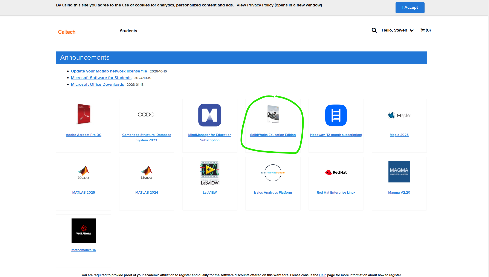
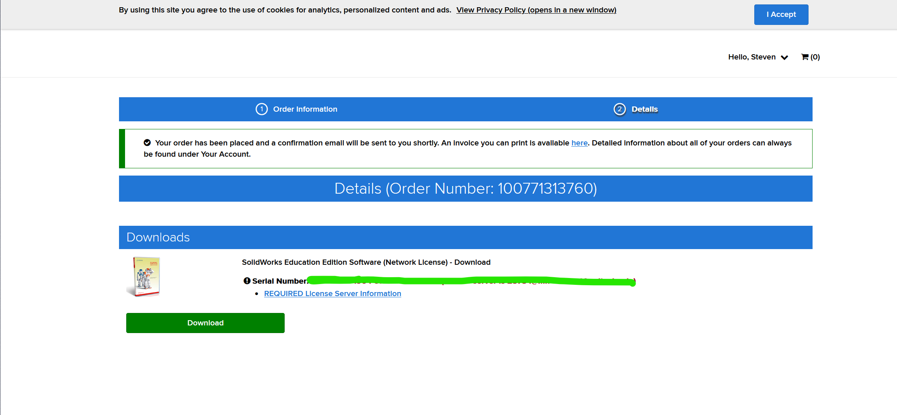
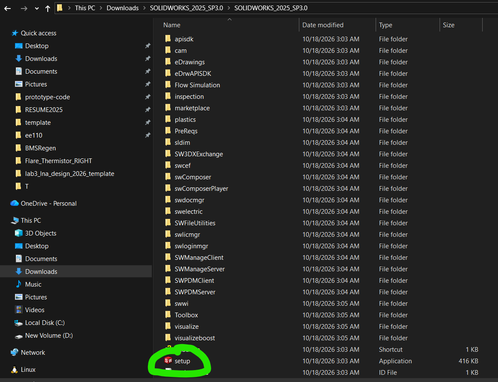

# Solidworks Setup for Windows

**Author**: Steven Lei

**Last updated**: 10/17/16

**NOTE**: make sure you are on campus WiFi (Caltech Secure) or using the campus
[VPN](https://www.imss.caltech.edu/services/wired-wireless-remote-access/virtual-private-network-vpn). 

Otherwise you cannot install the software. Note that installation could take a while (~15 GB download) depending on your WiFi speed.

## Download and Install

1) Go to [software.caltech.edu](https://software.caltech.edu/)

2) Click login and login with your Caltech credentials

3) Click Solidworks Education Edition 

4) Click "Add to cart"

5) Click "Check out"

6) You should see the green button with your order details. Click "Download".

7) Go to the downloaded SolidWorks folder. Right click -> extract all. Once
the folder has been extracted, click in and click the setup icon.

8) Follow the Solidworks installation manager. The default settings should be fine. Your serial number should be in your onthehub receipt.

